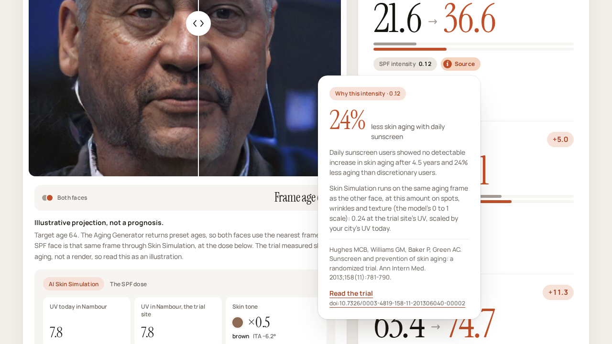
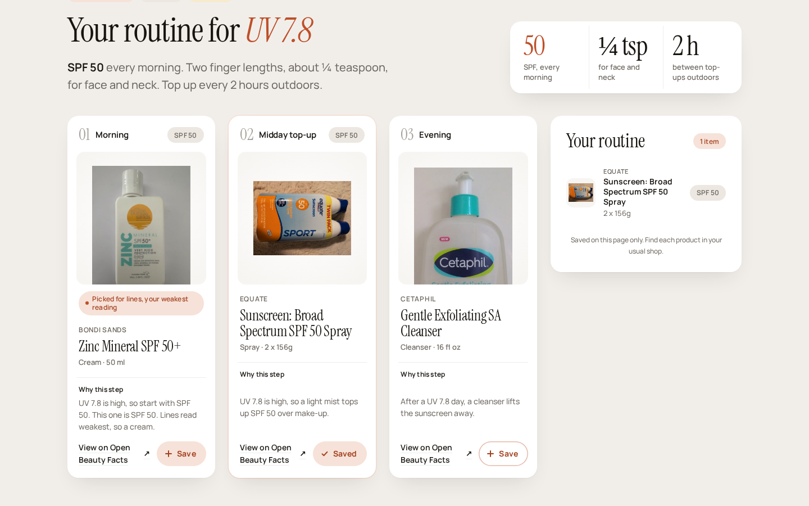
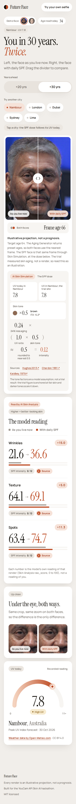
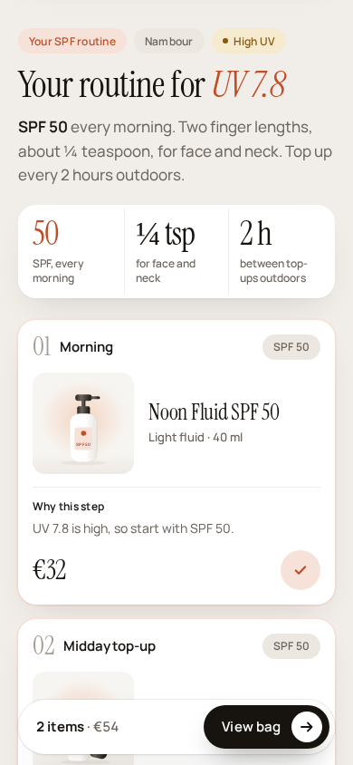

# Future Face

**Two faces of you in 20 or 30 years, side by side: one that kept living as now, and one that wore sunscreen every day, both read by the same model.**

One selfie goes through three YouCam APIs in a row. The **AI Aging Generator** projects you forward. Both faces start from the same aging frame for the full horizon. The "as you live now" face is that frame as it is; the "with daily SPF" face is that same frame run through **AI Skin Simulation** (spots, wrinkles and texture), at 0.24 x your city's UV / Nambour's UV. The 0.24 comes from a 4.5-year trial that found 24% less skin aging with daily sunscreen (Hughes et al., 2013), run in Nambour, Australia. **AI Skin Analysis** then reads both renders, so the gap shows up as numbers. Then the app sizes an SPF routine of real products (from Open Beauty Facts) to your city's UV index. A store can embed all of it on a product page with two lines of HTML.

On the demo face in 30 years (frame age 66 for both faces, with daily SPF at Nambour's own UV, intensity 0.24), Skin Analysis reads wrinkles **21.6 → 51.7**, texture **64.1 → 73.9** and spots **63.4 → 79.3** (raw_score, higher = better-looking skin). These are the model's readings of two renders. They are an illustrative projection, not a prognosis.


Built for the [YouCam API Skin AI & eCommerce VTO Hackathon](https://youcam-api-skin-ai-ecommerce.devpost.com/). Demo script: [docs/DEMO.md](docs/DEMO.md).

## Try it

Hosted at https://future-face.5-78-152-178.sslip.io. It opens on the recorded demo, so no key or account is needed. The live path is on for uploads: drop a selfie, type a city and it runs the three YouCam APIs on your photo.

## Try it in 30 seconds

No key, no account, no upload needed.

```sh
bun install
bun run dev
```

Open http://localhost:3000 and click **See your two futures**. That opens `/result`, a recorded live run of all three YouCam APIs on a public-domain face made by StyleGAN ([File:Man_2.jpg](https://commons.wikimedia.org/wiki/File:Man_2.jpg) on Wikimedia Commons, {{PD-algorithm}}; the person does not exist, see [fixtures/LICENSE.txt](fixtures/LICENSE.txt)). Drag the divider, switch **+20 yrs** / **+30 yrs**, click **Source** on any row, then **Build my SPF routine**.

You need Bun. Next.js also needs a recent Node.js on the path.

## How it works

1. **AI Aging Generator.** The selfie goes in. The API returns the age it reads today and a set of frames at preset ages (`res_age`). For each horizon (+20 and +30 years) the app picks one frame (ties go to the older frame): the frame nearest to today's age + years. Both faces use that same frame, so the gap between them is not a difference in age. One caption under the slider gives that frame for both faces: on the demo face at +30, "Both faces · Frame age 66".
2. **AI Skin Simulation.** The SPF face is that frame run through Skin Simulation with `spots`, `wrinkle` and `texture` all set to the same intensity on the model's 0 to 1 scale: **0.24 × (your city's UV / Nambour's UV)**. The ratio is rounded to the nearest 0.5 and kept between 0.5 and 2.5, so the intensity is one of 0.12, 0.24, 0.36, 0.48 or 0.6 (`spfDose` in [lib/evidence.ts](lib/evidence.ts)). Nambour is where the trial ran; its UV is the recorded Open-Meteo reading in [fixtures/demo/uv.json](fixtures/demo/uv.json). The two faces differ only by this pass. The result shows the dose as a formula under the slider, with both UV readings and the rounded ratio: on the demo, 0.24 × (UV 7.8 in Nambour / UV 7.8 in Nambour, the trial site, rounded to 1.0) = 0.24. The 0.24 comes from the 24% less skin aging reported for daily sunscreen users against discretionary users in Hughes MCB, Williams GM, Baker P, Green AC. *Sunscreen and prevention of skin aging: a randomized trial.* Ann Intern Med. 2013;158(11):781-790. doi:[10.7326/0003-4819-158-11-201306040-00002](https://doi.org/10.7326/0003-4819-158-11-201306040-00002). Every intensity on screen has a **Source** chip that opens this citation.
3. **AI Skin Analysis.** Both renders are read with the same SD actions (`wrinkle`, `age_spot`, `texture`). The **model reading** card shows each `raw_score` (0 to 100, higher = better-looking skin) for both faces and the difference. It is labelled as the model's reading of a render, not a reading of you.
4. **UV where you live.** The city you type is looked up on [Open-Meteo](https://open-meteo.com/) (free, no key), which returns today's peak UV index forecast. The UV card shows the reading with "Weather data by Open-Meteo.com · CC BY 4.0". The demo uses a recorded reading for Nambour, Queensland (UV 7.8), where the Hughes trial ran.
5. **Build my SPF routine.** The UV index sets the WHO band, and the band sets the routine: SPF 30 for low and moderate UV, SPF 50 for high and above. Two finger lengths (about ¼ teaspoon) for face and neck, and a top-up every 2 hours outdoors from moderate UV up. Each routine has three steps (morning, midday top-up, evening), drawn from real products in [fixtures/products.json](fixtures/products.json) (Open Beauty Facts data and photos, ODbL / CC BY-SA). Each card shows the photo, brand, SPF, size, why this step, and a link to the product on Open Beauty Facts. There are no prices: **Save** keeps a step in **Your routine**. `/result?product=<barcode>` makes that product the morning step and says whether its SPF covers the day; `/result?embed=1` is the same view for the store widget, and `/store/<barcode>` is a made-up shop, Sunday Pharmacy, showing the widget ([public/widget.js](public/widget.js)) embedded the way a store would.





On a phone, the routine button stays pinned and the saved routine opens as a bottom sheet from **View routine**:

<p>
  
  &nbsp;
  
</p>

## The three YouCam APIs

All calls are server-side, in [lib/youcam.ts](lib/youcam.ts). Each one registers and uploads the image, starts a task under `/s2s/v2.0/task/`, and polls until it finishes. The live chain is `runLive` in [lib/pipeline.ts](lib/pipeline.ts). [scripts/record.ts](scripts/record.ts) runs the same chain to record the demo.

| API | What it does here | Code |
| --- | --- | --- |
| AI Aging Generator | Reads today's age and returns `res_age` frames; per horizon (+20, +30 years) the app keeps the frame nearest to the full horizon, used by both faces | `ageFace`, `pickNearest`, `downloadFrame` in [lib/youcam.ts](lib/youcam.ts) |
| AI Skin Simulation | The "With daily SPF" face: the shared frame with spots/wrinkle/texture at 0.24 × (your UV / Nambour UV) | `simulateSkin` in [lib/youcam.ts](lib/youcam.ts); intensities and citation in [lib/evidence.ts](lib/evidence.ts) |
| AI Skin Analysis | Reads `wrinkle`, `age_spot` and `texture` raw_score on both renders | `analyzeSkin` in [lib/youcam.ts](lib/youcam.ts); `measuredLine` in [lib/pipeline.ts](lib/pipeline.ts) |

A live run costs about 46 YouCam units: aging about 2, two simulations about 4 each, four analyses about 9 each.

## Zero-key path

Without a key the app still works end to end:

- The landing button **See your two futures** and the `/result` page always show the recorded run in [fixtures/demo/](fixtures/demo/) (input face, frames, both renders and the Skin Analysis scores in [result.json](fixtures/demo/result.json)), with the recorded Nambour UV reading. The routine works on it as normal.
- An upload on the landing page (**Show my two futures**) still looks up your city's UV, then returns the recorded demo faces with a notice: "Live photos are turned off in this version of the app. The demo face still works." If the UV lookup is down, that result has no UV card and no routine button; the `/result` page always has both.

## Live runs and environment

Copy this into `.env` to run your own selfies through YouCam. Placeholder values only:

```sh
YOUCAM_SECRET_KEY=your-youcam-secret-key
# optional
YOUCAM_API_URL=https://yce-api-01.makeupar.com
LIVE_RUNS_MAX=5
```

| Variable | Needed for | Notes |
| --- | --- | --- |
| `YOUCAM_SECRET_KEY` | Live runs | Sent as the Bearer token on every YouCam call. Without it, uploads return the demo with a notice. |
| `YOUCAM_API_URL` | Optional | YouCam host. Defaults to `https://yce-api-01.makeupar.com`; an invalid URL falls back to the default. |
| `LIVE_RUNS_MAX` | Optional | Live runs allowed per server process, default 5, to protect units. Every attempt counts; the count resets on restart. Past it, uploads get `429 rate_limited`. |
| `FF_CATALOGUE` | Optional | Set to `generic` to use the six fictional products instead of the real ones in `fixtures/products.json`, so no brand names show. |
| `FF_URL` | Optional | Address of this app that the demo shop's widget points at. Read by `bun run store` on every run and saved in the shop; defaults to `http://localhost:3000`. |
| `FF_STORE_ADMIN_PASSWORD` | Optional | Admin password for the demo shop made by `bun run store`. If unset, a random one is printed once on first setup. |

## Scripts

| Command | What it does |
| --- | --- |
| `bun install` | Install dependencies |
| `bun run dev` | Dev server on http://localhost:3000 |
| `bun run test` | Unit tests (`bun test lib`) |
| `bun run typecheck` | `tsc --noEmit` |
| `bun run e2e` | Playwright: builds the app, serves it on port 3100 and runs [e2e/](e2e/). First time, run `bunx playwright install chromium`. |
| `bun run docker:build` | Build the Docker image `future-face` |
| `bun run docker:test` | Build the image, run unit tests, typecheck and e2e inside it, and fail unless all pass. Log lands in `test-results/docker-suite.log`. |
| `bun run store` | Start the demo WooCommerce shop on http://localhost:8080 (needs Docker) |
| `bun run store:down` | Stop the shop; its data is kept |
| `bun run record` | Re-records [fixtures/demo/](fixtures/demo/) with one live run on the source face. Needs `YOUCAM_SECRET_KEY`; costs about 46 units (reuses a recorded aging step if present). The source face lives in `fixtures/source/`, which is git-ignored. |
| `bun run products` | Refetches the sunscreens and cleansers from Open Beauty Facts into [fixtures/products.json](fixtures/products.json) and `public/products/` (free, no key) |
| `bun run record:uv` | Re-records today's Nambour UV reading into `fixtures/demo/uv.json` |

## Run it in Docker

No keys needed; the container serves the recorded demo.

```sh
bun run docker:build
docker run -p 3000:3000 future-face
```

Then open http://localhost:3000. To run the whole suite (unit tests, typecheck, Playwright) inside the image:

```sh
bun run docker:test
```

## Run it in a store (WooCommerce, two commands)

A real local WooCommerce shop with the Future Face plugin on every product page. Needs Docker; no accounts.

```sh
bun run store   # WordPress + WooCommerce on http://localhost:8080, products seeded
bun run dev     # this app on http://localhost:3000
```

`bun run store` prints the admin login (user `admin`) and the address of an SPF 50 product page. Open it and Future Face sits under the add-to-cart button. The shop carries WooCommerce's demo-store notice, and every price is a demo placeholder (one per kind of product, 9.90 to 18.90): Open Beauty Facts has no prices. Product data comes from [Open Beauty Facts](https://world.openbeautyfacts.org/), ODbL. Set `FF_STORE_ADMIN_PASSWORD` first to choose the admin password. The widget points at `http://localhost:3000` by default; if the app runs on another port, run `bun run store -- --url http://localhost:3100` (rerunning is safe; the `FF_URL` env var works too). `bun run store:down` stops the shop.

## Add it to your own store in two lines

```html
<script src="http://localhost:3000/widget.js" defer></script>
<div data-future-face data-product="3600000000000" data-spf="50" data-cart='{"3600000000000":"/?add-to-cart=12"}'></div>
```

- `data-product`: the product's barcode (8 to 14 digits).
- `data-spf`: the product's SPF number.
- `data-cart` (optional): JSON map from barcode to your add-to-cart URL, for every product in the shop, so the routine's products can go into the real cart.

On WordPress, the plugin in [store/future-face-woocommerce/](store/future-face-woocommerce/) does this on every single-product view. Set the app address under Settings > Future Face.

## API

| Route | What it returns |
| --- | --- |
| `GET /api/future` | The recorded demo result as JSON, with the recorded Nambour UV reading. Add `?city=Lisbon` for that city's live UV; if the lookup fails or finds nothing, the recorded reading is used. |
| `POST /api/future` | Multipart form with `selfie` (JPG or PNG, up to 10 MB) and `city`. With a key: a live run with both horizons, images as data URLs. Without a key: the demo result plus a `notice`. |
| `GET /api/demo-image/[name]` | A recorded demo JPEG (`input.jpg` or an image named in `result.json`); anything else is 404 |

Errors come back as `{ "error": { "kind": "...", "message": "..." } }`, where `message` is the on-screen text from [lib/copy.ts](lib/copy.ts).

| Status | `kind` | When |
| --- | --- | --- |
| 400 | `city_not_found` | `city` is missing or not 1 to 80 letters, spaces and `- ' . ,` (GET and POST); on POST, also when Open-Meteo finds no such city |
| 400 | `bad_format` | POST body is not a form, or has no `selfie` file |
| 413 | `file_too_large` | POST over 10 MB |
| 422 | `no_face`, `multiple_faces`, `face_too_small`, `bad_pose`, `bad_image_size`, `bad_format`, `file_too_large`, `low_quality` | YouCam rejected the photo, or it could not be decoded |
| 429 | `rate_limited` | `LIVE_RUNS_MAX` reached, or YouCam rate-limited the call |
| 503 | `insufficient_units`, `auth`, `server_busy`, `timeout`, `unknown` | Any other YouCam failure |
| 500 | `unknown` | Anything else |

`no_key` is never an error status: without a key, POST answers 200 with the demo and the `no_key` message as `notice`.

## Project layout

- [app/page.tsx](app/page.tsx): landing, with the in-place upload
- [app/result/page.tsx](app/result/page.tsx): the recorded demo result
- [app/components/](app/components/): `CompareSlider` (the before/after slider, shared by the landing hero and the result), `Result` (slider card, SPF dose formula, model reading, close-up, UV card), `Routine` (steps and saved list), `Upload`
- [app/api/future/route.ts](app/api/future/route.ts): the API above
- [lib/](lib/): YouCam client, pipeline, evidence, UV, routine, on-screen copy, banned-word check

## Wording

Everything on screen is an illustrative projection, not a prognosis. Scores are the model's readings of renders. Products are real Open Beauty Facts entries shown without prices (or six fictional ones with `FF_CATALOGUE=generic`), and Sunday Pharmacy is a made-up shop that sells nothing. [lib/banned.ts](lib/banned.ts) lists words the copy and these docs may not use, and the tests enforce it.

## Licenses and credits

- Code: MIT, see [LICENSE](LICENSE).
- Demo face and derived fixtures: public domain StyleGAN image from Wikimedia Commons ([File:Man_2.jpg](https://commons.wikimedia.org/wiki/File:Man_2.jpg), {{PD-algorithm}}); provenance in [fixtures/LICENSE.txt](fixtures/LICENSE.txt).
- UV data: [Weather data by Open-Meteo.com](https://open-meteo.com/), CC BY 4.0, credited on the UV card.
- Effect size: Hughes MCB et al., Ann Intern Med 2013;158(11):781-790, [doi:10.7326/0003-4819-158-11-201306040-00002](https://doi.org/10.7326/0003-4819-158-11-201306040-00002).
- Skin AI: YouCam AI Aging Generator, AI Skin Simulation and AI Skin Analysis.
