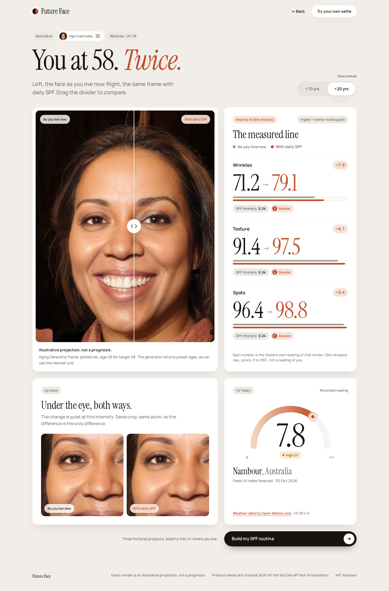

# Future Face

**Two faces of you, 10 or 20 years on, side by side: one that kept living as now, and the same face after daily sunscreen, both measured by the same model.**

One selfie goes through three YouCam APIs in a row. The **AI Aging Generator** projects you forward. **AI Skin Simulation** takes that same frame and dials spots, wrinkles and texture by 0.24, an intensity taken from a 4.5-year trial of daily sunscreen (Hughes et al., 2013). **AI Skin Analysis** then reads both renders, so the gap shows up as numbers. Then the app sizes an SPF routine to your city's UV index and lets you add it to a bag.

On the demo face at +20 years, Skin Analysis reads wrinkles **71.2 → 79.1**, texture **91.4 → 97.5** and spots **96.4 → 98.8** (raw_score, higher = better-looking skin). These are the model's readings of two renders. They are an illustrative projection, not a prognosis.



Built for the [YouCam API Skin AI & eCommerce VTO Hackathon](https://youcam-api-skin-ai-ecommerce.devpost.com/). Demo script: [docs/DEMO.md](docs/DEMO.md).

## Try it in 30 seconds

No key, no account, no upload needed.

```sh
bun install
bun run dev
```

Open http://localhost:3000 and click **See your two futures**. That opens `/result`, a recorded live run of all three YouCam APIs on a public-domain StyleGAN2 face (the person does not exist, see [fixtures/LICENSE.txt](fixtures/LICENSE.txt)). Drag the divider, switch **+10 yrs** / **+20 yrs**, click **Source** on any row, then **Build my SPF routine**.

You need Bun. Next.js also needs a recent Node.js on the path.

## How it works

1. **AI Aging Generator.** The selfie goes in. The API returns the age it reads today and a set of frames at preset ages (`res_age`). For each horizon the app picks the frame nearest to today's age + 10 and + 20 (ties go to the older frame) and says so under the image: "picked res_age 58 for target 58".
2. **AI Skin Simulation.** That same frame goes in with `spots`, `wrinkle` and `texture` at **0.24** each on the model's 0 to 1 scale. This is the "With daily SPF" face. The 0.24 comes from the 24% less skin aging reported for daily sunscreen users against discretionary users in Hughes MCB, Williams GM, Baker P, Green AC. *Sunscreen and prevention of skin aging: a randomized trial.* Ann Intern Med. 2013;158(11):781-790. doi:[10.7326/0003-4819-158-11-201306040-00002](https://doi.org/10.7326/0003-4819-158-11-201306040-00002). Every intensity on screen has a **Source** chip that opens this citation.
3. **AI Skin Analysis.** Both renders are read with the same SD actions (`wrinkle`, `age_spot`, `texture`). The **measured line** shows each `raw_score` (0 to 100, higher = better-looking skin) for both faces and the difference. It is labelled as the model's reading of a render, not a reading of you.
4. **UV where you live.** The city you type is looked up on [Open-Meteo](https://open-meteo.com/) (free, no key), which returns today's peak UV index forecast. The UV card shows the reading with "Weather data by Open-Meteo.com · CC BY 4.0". The demo uses a recorded reading for Nambour, Queensland (UV 7.8), where the Hughes trial ran.
5. **Build my SPF routine.** The UV index sets the WHO band, and the band sets the routine: SPF 30 for low and moderate UV, SPF 50 for high and above. Two finger lengths (about ¼ teaspoon) for face and neck, and a top-up every 2 hours outdoors from moderate UV up. Each routine has three steps (morning, midday top-up, evening), drawn from six fictional products. **Add** puts them in a bag with a subtotal. **Checkout** shows a demo note: no order is placed and nothing is charged.


On a phone, the routine button stays pinned and the bag opens as a bottom sheet from **View bag**:

<p>
  
  &nbsp;
  
</p>

## The three YouCam APIs

All calls are server-side, in [lib/youcam.ts](lib/youcam.ts). Each one registers and uploads the image, starts a task under `/s2s/v2.0/task/`, and polls until it finishes. The live chain is `runLive` in [lib/pipeline.ts](lib/pipeline.ts). [scripts/record.ts](scripts/record.ts) runs the same chain to record the demo.

| API | What it does here | Code |
| --- | --- | --- |
| AI Aging Generator | Reads today's age and returns `res_age` frames; the app keeps the two nearest to +10 and +20 years | `ageFace`, `pickNearest`, `downloadFrame` in [lib/youcam.ts](lib/youcam.ts) |
| AI Skin Simulation | Renders the "With daily SPF" face from the same frame, with spots/wrinkle/texture at 0.24 | `simulateSkin` in [lib/youcam.ts](lib/youcam.ts); intensities and citation in [lib/evidence.ts](lib/evidence.ts) |
| AI Skin Analysis | Reads `wrinkle`, `age_spot` and `texture` raw_score on both renders | `analyzeSkin` in [lib/youcam.ts](lib/youcam.ts); `measuredLine` in [lib/pipeline.ts](lib/pipeline.ts) |

A live run costs about 46 YouCam units: aging about 2, two simulations about 4 each, four analyses about 9 each.

## Zero-key path

Without a key the app still works end to end:

- The landing button **See your two futures** and the `/result` page always show the recorded run in [fixtures/demo/](fixtures/demo/) (input face, frames, both renders and the Skin Analysis scores in [result.json](fixtures/demo/result.json)), with the recorded Nambour UV reading. The routine and bag work on it as normal.
- An upload on the landing page (**Show my two futures**) still looks up your city's UV, then returns the recorded demo faces with a notice: "Live photos are turned off in this version of the app. The demo face still works." If the UV lookup is down, that result has no UV card and no routine button; the `/result` page always has both.

## Live runs and environment

Copy this into `.env` to run your own selfies through YouCam. Placeholder values only:

```sh
YOUCAM_SECRET_KEY=your-youcam-secret-key
# optional
YOUCAM_API_URL=https://yce-api-01.makeupar.com
LIVE_RUNS_MAX=5
```

| Variable | Needed for | Notes |
| --- | --- | --- |
| `YOUCAM_SECRET_KEY` | Live runs | Sent as the Bearer token on every YouCam call. Without it, uploads return the demo with a notice. |
| `YOUCAM_API_URL` | Optional | YouCam host. Defaults to `https://yce-api-01.makeupar.com`; an invalid URL falls back to the default. |
| `LIVE_RUNS_MAX` | Optional | Live runs allowed per server process, default 5, to protect units. Every attempt counts; the count resets on restart. Past it, uploads get `429 rate_limited`. |

## Scripts

| Command | What it does |
| --- | --- |
| `bun install` | Install dependencies |
| `bun run dev` | Dev server on http://localhost:3000 |
| `bun run test` | Unit tests (`bun test lib`) |
| `bun run typecheck` | `tsc --noEmit` |
| `bun run e2e` | Playwright: builds the app, serves it on port 3100 and runs [e2e/](e2e/). First time, run `bunx playwright install chromium`. |
| `bun run docker:build` | Build the Docker image `future-face` |
| `bun run docker:test` | Build the image, run unit tests, typecheck and e2e inside it, and fail unless all pass. Log lands in `test-results/docker-suite.log`. |
| `bun run record` | Re-records [fixtures/demo/](fixtures/demo/) with one live run on the source face. Needs `YOUCAM_SECRET_KEY`; costs about 46 units (reuses a recorded aging step if present). The source face lives in `fixtures/source/`, which is git-ignored. |
| `bun run record:uv` | Re-records today's Nambour UV reading into `fixtures/demo/uv.json` |

## Run it in Docker

No keys needed; the container serves the recorded demo.

```sh
bun run docker:build
docker run -p 3000:3000 future-face
```

Then open http://localhost:3000. To run the whole suite (unit tests, typecheck, Playwright) inside the image:

```sh
bun run docker:test
```

## API

| Route | What it returns |
| --- | --- |
| `GET /api/future` | The recorded demo result as JSON, with the recorded Nambour UV reading. Add `?city=Lisbon` for that city's live UV; if the lookup fails or finds nothing, the recorded reading is used. |
| `POST /api/future` | Multipart form with `selfie` (JPG or PNG, up to 10 MB) and `city`. With a key: a live run with both horizons, images as data URLs. Without a key: the demo result plus a `notice`. |
| `GET /api/demo-image/[name]` | A recorded demo JPEG (`input.jpg` or an image named in `result.json`); anything else is 404 |

Errors come back as `{ "error": { "kind": "...", "message": "..." } }`, where `message` is the on-screen text from [lib/copy.ts](lib/copy.ts).

| Status | `kind` | When |
| --- | --- | --- |
| 400 | `city_not_found` | `city` is missing or not 1 to 80 letters, spaces and `- ' . ,` (GET and POST); on POST, also when Open-Meteo finds no such city |
| 400 | `bad_format` | POST body is not a form, or has no `selfie` file |
| 413 | `file_too_large` | POST over 10 MB |
| 422 | `no_face`, `multiple_faces`, `face_too_small`, `bad_pose`, `bad_image_size`, `bad_format`, `file_too_large`, `low_quality` | YouCam rejected the photo, or it could not be decoded |
| 429 | `rate_limited` | `LIVE_RUNS_MAX` reached, or YouCam rate-limited the call |
| 503 | `insufficient_units`, `auth`, `server_busy`, `timeout`, `unknown` | Any other YouCam failure |
| 500 | `unknown` | Anything else |

`no_key` is never an error status: without a key, POST answers 200 with the demo and the `no_key` message as `notice`.

## Project layout

- [app/page.tsx](app/page.tsx): landing, with the in-place upload
- [app/result/page.tsx](app/result/page.tsx): the recorded demo result
- [app/components/](app/components/): `Result` (slider, measured line, close-up, UV card), `Routine` (steps and bag), `Upload`
- [app/api/future/route.ts](app/api/future/route.ts): the API above
- [lib/](lib/): YouCam client, pipeline, evidence, UV, routine, on-screen copy, banned-word check

## Wording

Everything on screen is an illustrative projection, not a prognosis. Scores are the model's readings of renders. The products are fictional, and checkout places no order. [lib/banned.ts](lib/banned.ts) lists words the copy and these docs may not use, and the tests enforce it.

## Licenses and credits

- Code: MIT, see [LICENSE](LICENSE).
- Demo face and derived fixtures: public domain StyleGAN2 image from Wikimedia Commons; provenance in [fixtures/LICENSE.txt](fixtures/LICENSE.txt).
- UV data: [Weather data by Open-Meteo.com](https://open-meteo.com/), CC BY 4.0, credited on the UV card.
- Effect size: Hughes MCB et al., Ann Intern Med 2013;158(11):781-790, [doi:10.7326/0003-4819-158-11-201306040-00002](https://doi.org/10.7326/0003-4819-158-11-201306040-00002).
- Skin AI: YouCam AI Aging Generator, AI Skin Simulation and AI Skin Analysis.
